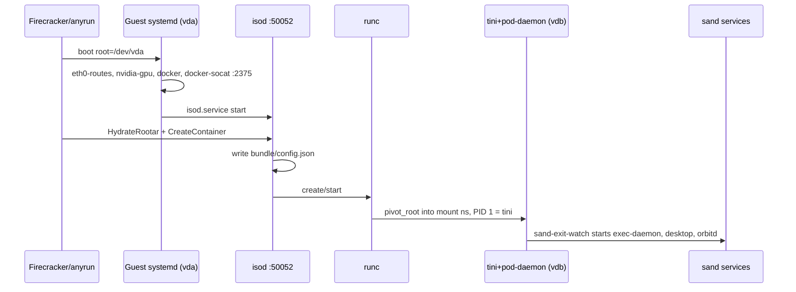

# Grok Bot Box 全链路启动：Firecracker → systemd → isod → runc → sand

> 本文是底座启动链的权威叙事。时间用 Asia/Shanghai（UTC+8）。凭据已脱敏。  
> 证据在同目录 [`artifacts/`](artifacts/)。仓库根的 sysinfo 和 [`sand-scripts/`](../../sand-scripts/) 是 **容器内部** 的视角，读的时候和本文对看。

## 怎么读

1. 第 0–1 节：客户机底座（Debian 12、`/dev/vda`、systemd、isod）。
2. 第 2–3 节：控制面怎么 hydrate，runc 怎么把容器根切到 `/dev/vdb`。
3. 第 4 节：容器里的 sand 服务。脚本注释版在 [`sand-scripts/README.md`](../../sand-scripts/README.md)。
4. 第 5–7 节：两块盘、`/opt`、开源边界。
5. 更早的现场重建、state 摘要和 Debian 12 模拟步骤在 [`artifacts/docs/`](artifacts/docs/)。

## 0. 两层机器

采集命令是在 **容器里面** 跑的。所以仓库根里 PID 1 是 `tini`，`findmnt /` 是 `/dev/vdb`。客户机真正的 PID 1 在另一层：vda 上的 **systemd**。

| 层 | 组件 | 开源？ | 作用 |
|----|------|--------|------|
| 宿主机 | Firecracker / anyrun VMM | 引擎开源，编排闭源 | 启动 microVM，挂 vda/vdb，注入 cmdline |
| Guest 底座 rootfs | Debian 12 on `/dev/vda` | 发行版开源 | systemd、docker、**isod**、runc、nvidia 内核模块 |
| Isolation Daemon | `/usr/local/bin/isod` | **闭源**（Anysphere `everysphere` / anyrun） | gRPC `:50052`，HydrateRootar + CreateContainer，驱动 runc |
| OCI runtime | `runc` 1.3.6 | Apache-2.0 | 按 `bundle/config.json` 在新 mount namespace 里 `pivot_root` |
| 容器 rootfs | `/dev/vdb`（ext4） | 镜像闭源 | Debian 13 风格 sand-box |
| 容器 PID 1 | `tini` → `pod-daemon` | tini 开源；pod-daemon **闭源** | 进程管理 + gRPC；拉起 sand 服务栈 |

本实例容器 id：`pod-nzlapxyzlvdmnjzu6uf6mcaaly-02fe127a`。  
runc 记录的创建时间：`2026-10-18T08:10:57.695Z`，即 **2026-10-18 16:10:57**。  
仓库根 sysinfo 的采集时刻是同一天 **18:35:26**，已经在这个容器里面。

## 1. 机器冷启动（底座）

### 1.1 内核 cmdline

全文在 [`artifacts/vda-systemd/live-proc-cmdline.txt`](artifacts/vda-systemd/live-proc-cmdline.txt)。和容器里的 [`cmdline.txt`](../../cmdline.txt) 是同一串启动参数。要点：

- `root=/dev/vda` 出现两次，带 `rw`（底座根）
- `ip=172.30.0.2::172.30.0.1:255.255.255.0::eth0:off`
- `systemd.unified_cgroup_hierarchy=1`
- `systemd.setenv=SWAP_SIZE_MB=0`
- `nomodule`（无 GPU passthrough 时禁用模块加载；GPU VM 会放开）
- `console=ttyS0`、`earlyprintk=ttyS0`
- `clocksource=kvm-clock`、`reboot=k`、`panic=1`

内核把 vda 挂成客户机根之后，客户机 PID 1 是 **systemd**（`/sbin/init`）。这一步没有把整机切到 vdb。

### 1.2 multi-user.target 上启用的服务

[`artifacts/vda-systemd/multi-user.target.wants.ls.txt`](artifacts/vda-systemd/multi-user.target.wants.ls.txt) 里和启动链有关的是：

| 单元 | 做什么 |
|------|--------|
| **eth0-routes.service** | `Before=docker.service isod.service`。oneshot，`/usr/local/bin/eth0-routes reconcile`，保住 `192.168.0.0/16`、`172.16.0.0/12`、`10.0.0.2/32` 走 eth0 主表 |
| **nvidia-gpu.service** | `/usr/local/bin/nvidia-gpu-setup.sh`。PCI 上没有 NVIDIA（vendor `0x10de`）就直接退出。`TimeoutStartSec=30`，故意不挡 docker |
| **containerd.service** / **docker.service** | 底座上的容器引擎 |
| **docker-socat.service** | `socat TCP-LISTEN:2375` 接到 `/var/run/docker.sock`，给宿主机/编排用 |
| **isod.service** | `/usr/local/bin/isod --listen-addr 0.0.0.0:50052 --base-dir /var/lib/isod` |

同目录还有 `e2scrub_reap.service`、`netfilter-persistent.service`、`remote-fs.target`。  
**没有** swap 单元。`setup-swap.sh` 在 `/usr/local/bin`，cmdline 把 `SWAP_SIZE_MB` 设成 0；这份 wants 列表里看不到它被启用。

原始 unit 在 [`artifacts/vda-systemd/`](artifacts/vda-systemd/)，脚本在 [`artifacts/vda-scripts/`](artifacts/vda-scripts/)。底座 `/etc/fstab` 是一行注释：`UNCONFIGURED FSTAB FOR BASE SYSTEM`。`modules-load.d` 里 `modules.conf` 是指向 `../modules` 的符号链接（打包时目标文件没有一并摘出），旁边是 `iptables.conf` 列出的 netfilter 模块名。

### 1.3 isod 进程

- 二进制：Rust musl 静态链接，30414768 字节。sha256 `719a0d2681dc09d5e83764700129b83f9a771b19d8fc0fdd9ed525bb87b2a55c`（[`isod.sha256`](artifacts/vda-anyrun/isod.sha256)）。本仓库不收录二进制。
- [`/etc/anyrun/build-info`](artifacts/vda-anyrun/build-info)：`commit=5a6eda56ad88e83520c0fe05e00af251ccf56737`，`branch=main`，`generation=141355`，`cargo_version=0.1.0`，`built_at_unix=1792111808`（**2026-10-16 08:50:08**）。文件头写明 Firecracker rootfs / isod，进程启动时加载。
- 日志走 journald（`RUST_LOG=info`）。容器内看不到底座 journal。
- `--help`：默认 `--base-dir /tmp/isod`、`--listen-addr 127.0.0.1:50052`。unit 把两者都覆盖了。见 [`isod-help.txt`](artifacts/vda-anyrun/isod-help.txt)。
- 字符串抽出的 RPC 是 `anyrun.v1.IsodService`，完整列表在 [`isod-IsodService-rpcs.txt`](artifacts/vda-anyrun/isod-IsodService-rpcs.txt)。源路径线索在 [`isod-source-paths.txt`](artifacts/vda-anyrun/isod-source-paths.txt) 和 [`daemon-util-source-paths.txt`](artifacts/vda-anyrun/daemon-util-source-paths.txt)（`rootar_hydrate.rs`、`extra_drives.rs`、`daemon-util` 的 rootar v1/v5）。

unit 注释写明：重启 isod 用 `KillMode=process`，避免 SIGKILL runc 监督进程和 workload cgroup。下次启动从 runc、磁盘和 mountinfo 重新收养容器。

**isod 不开源**，源码在私有 `anysphere/everysphere`。这里只有 hash、`--help`、stat 和字符串列表。

## 2. 控制面：hydrate + 建容器

控制面在 anyrun 宿主机侧，不在 guest 里。它通过 gRPC 调 isod。RPC 名单和 isod 内部符号支持的典型顺序是：

```text
MountExtraDrives / 块设备就绪（guest_device 为 /dev/vdb … /dev/vdz）
    → HydrateRootar（LEGACY | V1 | V2 | V2_LAYERED | V3 | V4 | V5）
        → 用 presigned_url，或 lease_token + blob，下载 rootar
        → 解压或挂到容器 image/rootfs（squashfs / erofs / ext4 / overlay，视模式而定）
    → CreateContainer（写 OCI bundle/config.json）
    → StartContainer（runc create + start）
```

各 hydrate 模式的字符串级推断写在 [`artifacts/docs/BOOT-TRACE.md`](artifacts/docs/BOOT-TRACE.md)：V2/V3 常见 squashfs + overlay，V4 可以是 squashfs / erofs / ext4，V5 强制 ext4。磁盘上 **没有留下** `meta.json` 或 hydration metadata，所以 V4、V5 和「把可写 ext4 populate 到 vdb」无法 100% 钉死。能钉死的是结果：容器 `/` 的后端是 `/dev/vdb`，LABEL `ext4-writer`。

本实例留下的目录（从容器内把 vda 挂到 `/mnt/vda` 之后看到）：

| 路径 | 谁写的 | 现场 |
|------|--------|------|
| `/var/lib/isod/containers/<id>/bundle/config.json` | isod | OCI 配置。脱敏全文 [`config.redacted.json`](artifacts/vda-isod-state/config.redacted.json) |
| `/var/lib/isod/containers/<id>/image/rootfs` | hydrate / mount 的目标 | 二次挂载 vda 时这个目录是空的：vdb 的挂载只存在于底座 mount namespace |
| `/var/lib/isod/runc-state/<id>/state.json` | runc | 运行时状态。脱敏全文 [`state.redacted.json`](artifacts/vda-isod-state/state.redacted.json)，摘要 [`runc-state.summary.md`](artifacts/docs/runc-state.summary.md) |

布局原文：[`isod-var-lib-layout.txt`](artifacts/vda-isod-state/isod-var-lib-layout.txt)。

### 2.1 OCI config 要点

- `process.args`：`/tini -- /pod-daemon --ssh-auth-sock-path /run/host-services/ssh-auth.sock --ssh-auth-vsock-port 52`
- `root.path`：`/var/lib/isod/containers/pod-nzlapxyzlvdmnjzu6uf6mcaaly-02fe127a/image/rootfs`，`readonly: false`
- `hostname`：`grok-bot-vm-477963022`
- mounts 只有四条：`/proc`、`/dev`（bind）、`/dev/shm`、`/sys`（bind）。bind 了整个 `/dev`，所以容器里 `lsblk` 看得到 vda 和 vdb
- namespaces：新建 pid / ipc / uts / mount。**network 加入底座 `/proc/1/ns/net`**（底座 systemd 的网络命名空间）
- capabilities：bounding / effective / inheritable / permitted / ambient 都是接近全集的同一组；`noNewPrivileges: false`
- `resources.devices`：允许所有设备 `a:rwm`
- state 里嵌的 `no_pivot_root`：**false**，runc 会 `pivot_root`

`config.redacted.json` 只把凭据涂成 `<redacted>`（`SAND_BOX_AUTH_ID`、`SAND_EGRESS_TUNNEL_BEARER`、`SAND_GATEWAY_TOKEN`、`SAND_INFERENCE_RENEWAL_CREDENTIAL`）。集群名、store id、端口和屏幕尺寸仍是现场值。[`runc-config.sanitized.json`](artifacts/docs/runc-config.sanitized.json) 把几乎所有 `SAND_*` 都写成 `REDACTED`，结构相同，不要把它当成环境变量的现场值。

### 2.2 runc state 要点

- `init_process_pid`：**1317**。这是底座 pid namespace 里的容器 init，容器内看它就是 PID 1
- `created`：2026-10-18 16:10:57
- `rootless`：false
- OCI / runc：state `version` 1.2.1；底座二进制 `runc 1.3.6`（commit `v1.3.6-0-g491b69ba`，spec 1.2.1）
- `cgroup_paths[""]`：`/sys/fs/cgroup/system.slice/pod-nzlapxyzlvdmnjzu6uf6mcaaly-02fe127a`
- `namespace_paths`：指向 `/proc/1317/ns/*`（含 cgroup、ipc、net、mnt、pid、time、user、uts）

容器内 cgroup 文件 [`process/pid1-cgroup.txt`](../../process/pid1-cgroup.txt) 是同一条：`0::/system.slice/pod-nzlapxyzlvdmnjzu6uf6mcaaly-02fe127a`。

## 3. runc 切入容器

1. isod 调用底座 `/usr/bin/runc`（1.3.6，约 12012640 字节；`/usr/sbin/runc` 不存在）。
2. runc 按 bundle 建 mount namespace，对 `image/rootfs` 做 `pivot_root`。
3. 容器内 PID 1 = **tini 0.19.0**（`git.de40ad0`）。
4. tini 只 exec **一个** 子进程：`/pod-daemon`，参数与 OCI `process.args` 一致。

两份二进制的 sha256（[`tini-pod-daemon.sha256`](artifacts/container-init/tini-pod-daemon.sha256)）：

| 文件 | sha256 | 大小 |
|------|--------|------|
| `/mnt/vda/usr/local/bin/tini` 与容器 `/tini` | `c5b0666b4cb676901f90dfcb37106783c5fe2077b04590973b885950611b30ee`（相同） | 870496 |
| 底座 `/usr/local/bin/pod-daemon` | `4a2382acdfffb27ab24c78b852209a693ee5a5c4f543b79f96cc7ca2cc081f48` | 19534104 |
| 容器 `/pod-daemon` | `438be2eef1059fd69cbefc3ab8607af5c48f731a7ab8e47ed5a850c941adb080` | 20336480 |

tini 是同一份。pod-daemon 是镜像里另一份更新的二进制，和底座 `/usr/local/bin/pod-daemon` 不是同一个文件。

容器里的根：

```text
/  ← /dev/vdb (ext4, rw,relatime)
```

[`findmnt-root.txt`](artifacts/container-init/findmnt-root.txt) 与仓库根 [`disk/findmnt.txt`](../../disk/findmnt.txt) 一致。分析时 vda 被另外挂在容器内 `/mnt/vda`（约 1% 已用），那是调查用的二次挂载，不是容器的 `/`。

## 4. 容器内服务栈（sand-box）

### 4.1 进程树

容器内简化树（现场命令行见 [`ps-ef-head.txt`](artifacts/container-init/ps-ef-head.txt) 和 [`process/pstree.txt`](../../process/pstree.txt)）：

```text
1  /tini -- /pod-daemon --ssh-auth-sock-path ... --ssh-auth-vsock-port 52
└─ 7  /pod-daemon
   ├─ sand-exit-watch          python subreaper；--exec-owner / --supervise-owner / orbitd launcher
   │    ├─ sand-window-router.mjs :1339
   │    ├─ sand-session-sync / sand-web-bot-auth / sand-ua-governor / sand-cookie-persist
   │    ├─ supervise-exec-daemon → start-exec-daemon → exec-daemon :1337 / PTY :1338
   │    ├─ supervise-egress-tunnel → sand-egress-tunnel server
   │    ├─ supervise-sand-supervisor → sand-supervisor.mjs
   │    ├─ start-desktop.sh → Xvfb :1 1920×1200
   │    ├─ websockify :6081（fork noVNC，token 文件）
   │    ├─ sand-memory-watch
   │    └─ sand-daemon-supervisor run orbitd → orbitd
   └─ cursor-agent-store-fuse   （快照里有；脚本不在本仓库）
```

`start-sand-box` 在 exec 之后不会留在树上。它负责准备目录、身份和 cgroup，把上面这些长期进程放进后台，再把自己换成 `sand-exit-watch`。带中文注释的全文在 [`sand-scripts/boot/start-sand-box`](../../sand-scripts/boot/start-sand-box)。

挂到 tini（PID 1）下面的 `dbus-daemon` 是桌面会话孤儿被 init 收养，不是 tini 启动的服务。容器内看不到 systemd 单元（[`container-systemd-units.ls.txt`](artifacts/container-init/container-systemd-units.ls.txt) 为空）。

[`artifacts/container-scripts/`](artifacts/container-scripts/) 是原文摘录，没有中文注释，也不是完整脚本树：有 `sand-exit-watch`、三对 `supervise-*` / `start-*`、`start-desktop.sh`、`box-bounded-log`、`orbitd-start`。阅读用的超集（含 `start-sand-box`、桌面包装和 supervisor 模块）在 [`sand-scripts/`](../../sand-scripts/)。

### 4.2 pod-daemon

- 闭源 Rust。`--help` 的默认 gRPC 是 `0.0.0.0:26500`（[`pod-daemon-help.txt`](artifacts/container-init/pod-daemon-help.txt)）。
- 本实例 argv 没有 `--listen-addr`，也没有 `--auth-token-sha256`，所以走默认监听。`--api-listen-addr` 未设置。
- 负责进程管理、日志 attach，以及 **SSH auth sock ↔ vsock:52**。`--help` 写明这两个 SSH 参数必须成对出现，现场 argv 确实成对。
- 采集时 `ss` 的 **26500** 没有进程名。地址和默认监听一致；进程列为空，是因为这次 `ss` 没标出它，不是另有一个未识别的服务。

### 4.3 容器里能直接碰到的端口

数字以 [`sand-scripts/utils/box-contract.generated.mjs`](../../sand-scripts/utils/box-contract.generated.mjs) 和根目录端口表为准。和底座共享网络命名空间之后，容器里的 `ss` 还会看到底座的监听。

| 能力 | 进程 / 端口 | 谁的命名空间 |
|------|-------------|--------------|
| Shell / exec / computer-use | exec-daemon `:1337`，PTY websocket `:1338` | 容器 |
| 窗口路由 | `sand-window-router.mjs` `:1339` | 容器 |
| in-box host gateway | `:1340` | 容器 |
| 主桌面 | Xvfb `:1` 1920×1200；x11vnc `:5900`；noVNC `:6080` | 容器 |
| fork 桌面 | noVNC / websockify `:6081`（token 文件）；VNC `5900+屏号` | 容器 |
| 出站隧道 | WebSocket `:8790`，CONNECT 代理 `127.0.0.1:8791` | 容器 |
| Agent 侧车 | orbitd，经 `sand-daemon-supervisor` | 容器 |
| 监督 | `sand-exit-watch`、`sand-supervisor.mjs` | 容器 |
| isod gRPC | `:50052` | 底座进程，共享 netns，容器内 `ss` 听得到、对不上进程名 |
| Docker API | `:2375`（docker-socat） | 同上 |
| pod-daemon gRPC | `:26500`（默认） | 容器内进程；见 4.2 |
| SSH agent 桥 | vsock 端口 52 | 不是 TCP |

主桌面 noVNC 是 **6080**。6081 是 fork 窗口那一路（`ps` 里带 `--token-source /tmp/sand-novnc-tokens.d`）。根目录 [`network/ss-lntp.txt`](../../network/ss-lntp.txt) 两次都有。

## 5. 磁盘：两套 rootfs

| 设备 | 角色 | 本实例 |
|------|------|--------|
| `/dev/vda` | anyrun 底座：Debian 12 + systemd + isod + docker + nvidia 用户态包 | 客户机根。分析时挂到容器内 `/mnt/vda`。UUID `e6bda90c-4d45-4cd5-8585-21f19fae583d` |
| `/dev/vdb` | sand-box 工作根 | 容器 `/`。LABEL `ext4-writer`，UUID `00000000-0000-0000-0000-000000000004` |

两块都是约 128GiB 的 virtio 盘，不是同一文件系统的两个名字。

内核 dmesg 先记录 `VFS: Mounted root` 在 `254:0`（vda），随后 `EXT4-fs (vdb): mounted`。`/proc/cmdline` 是启动参数快照，不会跟着容器的 `pivot_root` 改写。容器 mount namespace 里的 `/` 来自 vdb；底座 systemd 的 `/` 仍是 vda。

所以仓库根 [`SUMMARY.md`](../../SUMMARY.md) 里「用户态切根」指的是 **runc 在容器 mount namespace 里的 `pivot_root`**。范围是这个容器，不是把整台客户机的根从 vda 换成 vdb。

## 6. 底座 `/opt`

清单在 [`artifacts/vda-opt-nvidia-meta/`](artifacts/vda-opt-nvidia-meta/)，没有收录 `.so` 本体。

- `/opt/nvidia`：用户态驱动 **580.95.05**（`libcuda.so.580.95.05` 等），体量约 277MiB，另有 `nvidia-smi`。
- `/opt/containerd`：空目录骨架。
- GPU 用户态库注入 workload。底座 `nvidia-gpu-setup.sh` 只在看到 NVIDIA PCI 时 `modprobe` 并创建 `/dev/nvidia*`。本实例 cmdline 带 `nomodule`，脚本会在没有 GPU 时直接退出。

## 7. 开源边界

| 可以按公开组件复现形状 | 闭源，这里只有外部行为 |
|------------------------|------------------------|
| runc、tini、Debian、systemd、docker / containerd、eth0-routes 与 nvidia setup 脚本 | isod、pod-daemon、rootar 控制面、everysphere anyrun |
| OCI config、runc state、unit | HydrateRootar 的服务端实现 |

在 Debian 12 上用 loop 盘走一遍「第二块盘 → 挂到 `image/rootfs` → `runc run`」的步骤在 [`artifacts/docs/SIMULATE-DEBIAN12.md`](artifacts/docs/SIMULATE-DEBIAN12.md)。那个实验用 `sleep` 代替 pod-daemon，只对齐磁盘和 runc 边界。

## 8. artifacts 目录

```text
docs/boot-chain/BOOT-CHAIN-FULL.md          本文件
docs/boot-chain/artifacts/
  vda-systemd/          isod、nvidia-gpu、docker-socat、eth0-routes 的 unit，fstab，cmdline，wants 列表
  vda-scripts/          eth0-routes、nvidia-gpu-setup.sh、setup-swap.sh，runc 版本与路径
  vda-anyrun/           build-info，isod --help，sha256/md5/stat，RPC 与源路径
  vda-isod-state/       config.redacted.json、state.redacted.json、var/lib 布局
  vda-opt-nvidia-meta/  /opt 清单（不含 .so）
  container-scripts/    sand 脚本原文（子集，无中文注释）
  container-init/       容器内 ps、findmnt、sha256 对比、pod-daemon --help
  docs/                 早期 BOOT-TRACE、SIMULATE-DEBIAN12、runc state 摘要、更彻底脱敏的 OCI
```

## 9. 流程图


