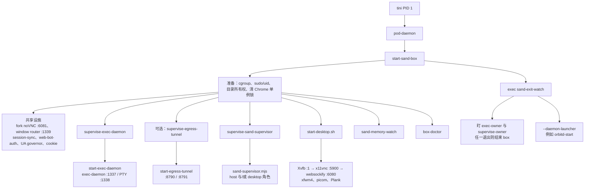

# 沙箱脚本阅读指南

这些文件是从一台正在运行的 **Grok Bot** 沙箱（Debian 13 / KVM）上摘下来的文本，对应沙箱里的 `/usr/local/bin/…`。唯一的例外是 `boot/orbitd-start`，它来自 `/usr/local/libexec/sand/orbitd/start`。

用途是学习：box 怎样从 `start-sand-box` 走到各个长期服务。代码属于 **Anysphere / Cursor sand** 运行时，是专有学习摘录，不是官方发布，也不构成再分发许可。本目录与 Anysphere / Cursor 无隶属关系。没有二进制、cookie 或密钥。

系统快照（进程、磁盘、端口现场）在仓库根目录，见 [`../README.md`](../README.md)。这些脚本跑在 runc 容器里面。客户机底座（systemd → isod → runc）在 [`../docs/boot-chain/BOOT-CHAIN-FULL.md`](../docs/boot-chain/BOOT-CHAIN-FULL.md)；同名脚本的无注释原文在 [`../docs/boot-chain/artifacts/container-scripts/`](../docs/boot-chain/artifacts/container-scripts/)。

---

## 启动时序

`start-sand-box` 是一次性编排脚本。它把长期进程放到后台，然后用 `exec` 换成 `sand-exit-watch`。所以进程树上长期留着的是 Python watch，不是 bash。

桌面内部的顺序（`start-desktop.sh`）是：清 token → 保证 machine-id → 会话 D-Bus → Xvfb，等到 `xdpyinfo` 成功 → 壁纸 → x11vnc →（没有 noVNC token 时）websockify → xfwm4，等到 WM → picom → 写入 Chrome/文件选择器的 desktop 与 dconf → Plank。最后 `tail -f /dev/null`，让这个会话进程一直活着，好让桌面监督能看见它。

`start-sand-box` 自己也会等最多约 30 秒看 `DISPLAY` 是否起来，并往遥测日志写 `desktop_up` 或 `desktop` 失败。等不到也不中断后续的 `exec`。

---

## 四个子目录

| 目录 | 什么时候读 | 里面有什么 |
|------|------------|------------|
| [`boot/`](boot/) | 先读 | 编排入口、退出/内存两个 watch、三对 supervise/start、orbitd launcher |
| [`desktop/`](desktop/) | 要看画面怎么出来 | 主桌面、fork 窗口、五个 `box-*` 包装、窗口路由、桌面监督用的登记脚本 |
| [`supervisor/`](supervisor/) | 要看 host 怎么被拉起和升级 | `sand-supervisor.mjs` 加上契约、策略、bundle 替换、进程身份、cgroup 采样 |
| [`utils/`](utils/) | 被上面 source 或包在外面 | cgroup、有界日志、端口契约、doctor、machine-id |

调用方向是单向的：`boot/` 启动 `desktop/` 和 `supervisor/`，两边都调用 `utils/`。`supervisor/` 再回头读 `desktop/` 登记在 `/tmp/sand-desktop` 里的组件规格，决定要不要重拉 Xvfb 或 VNC。

---

## `supervise-*` 和 `start-*` 怎么配合

这是读 `boot/` 时最容易混的一点。

**`start-*` 是一次启动。** 它负责切到正确的工作目录、丢掉不该继承的 token，然后 `exec` 真正的二进制。它自己不循环。

**`supervise-*` 是重启循环。** 它收到端口或状态文件路径和 launcher 路径，做这几件事：

1. 如果端口上还有上一代进程，先 TERM，再 KILL，避免 `EADDRINUSE`。
2. `setsid` 拉起 `start-*`（或 `node sand-supervisor.mjs`），子进程独立成会话。
3. 探活：exec-daemon 和 egress 看端口是否在听；sand-supervisor 看 `status.json` 是否比本次启动更新、并且还在被改写。
4. 子进程退出或探活失败就退避重试（大约 1s 起、封顶 30s）。子进程若活过约 60 秒，退避退回 1 秒。
5. 收到 TERM/INT 时停掉子进程并自己退出 0。这个退出会被 `sand-exit-watch` 看成生命周期主人死亡。

三对对应关系：

| 监督脚本 | 它启动的 launcher | 探活对象 | 谁把它放进后台 |
|----------|-------------------|----------|----------------|
| `supervise-exec-daemon` | `start-exec-daemon` | TCP `1337` | `start-sand-box`。该 supervise 进程的 PID 就是 `--exec-owner` |
| `supervise-egress-tunnel` | `start-egress-tunnel` | 隧道 WebSocket 端口（默认 `8790`） | `start-sand-box`，且仅当 `SAND_EGRESS_TUNNEL_ENABLED=1` |
| `supervise-sand-supervisor` | `node sand-supervisor.mjs` | `status.json` 的更新 | `start-sand-box` 里的 `start_in_box_supervisor`。PID 就是 `--supervise-owner` |

uid split（host 用 `sand-host`、agent 用 `box`）打开时，egress 不再交给桌面监督登记，而是由 `start-sand-box` 自己包一层重启循环；supervisor 会拆成两个进程：角色 `host` 的一份和角色 `desktop` 的一份。没开 split 时，一份 `sand-supervisor.mjs` 同时管 host 和桌面。

**orbitd 不走这三对。** `start-sand-box` 只是发现 `/var/lib/sand-daemon-supervisor/<服务>/bundled` 里有可执行文件和 manifest，再把 `--daemon-launcher orbitd=/usr/local/libexec/sand/orbitd/start` 塞给 `sand-exit-watch`。watch 用 `subprocess` 拉起 `orbitd-start`，退出后按自己的退避重开。`orbitd-start` 里面再 exec `sand-daemon-supervisor`。镜像 daemon 挂了不会结束 box；两个 lifecycle owner 挂了会。

`sand-supervisor.mjs` 被标成镜像自带脚本（见 `sand-supervisor-contract.mjs` 里的 `IMAGE_OWNED_SCRIPT_NAMES`）。host bundle 可以同步别的 box 脚本，但不会覆盖 `start-sand-box`、`sand-exit-watch`、`supervise-*` 这几份，避免一次升级把正在跑的启动链换掉。

---

## 各文件在链上的位置

和根目录清单同一口径，这里按阅读顺序再列一次，方便只打开本目录的人。

### `boot/`

| 文件 | 作用 |
|------|------|
| `start-sand-box` | 编排。准备完就 exec 成下一行 |
| `sand-exit-watch` | 接过编排进程的位置：subreaper、owner、镜像 daemon |
| `sand-memory-watch` | 旁路采样，不参与启停 |
| `supervise-exec-daemon` / `start-exec-daemon` | 监督 / 一次启动 exec-daemon |
| `supervise-egress-tunnel` / `start-egress-tunnel` | 监督 / 一次启动出口隧道 |
| `supervise-sand-supervisor` | 监督 `sand-supervisor.mjs` |
| `orbitd-start` | 镜像 daemon launcher，由 exit-watch 调用 |

### `desktop/`

| 文件 | 作用 |
|------|------|
| `start-desktop.sh` | 主屏 `:1` 的整套 X / VNC / WM / dock |
| `start-window` / `stop-window` | `:2+` 的额外窗口；两者都拒绝动主屏 |
| `box-xvfb` `box-x11vnc` `box-xfwm4` `box-picom` `box-plank` | 启动前清掉同屏残留，再 exec 对应程序 |
| `sand-desktop-supervise.sh` | 把「怎么重拉这个组件」写成 JSON 规格 |
| `sand-desktop-unit.sh` | 按 profile 找到一组 pid，供 stop-window 发信号 |
| `sand-window-router.mjs` | `:1339` 路由到主 exec-daemon 或 `14000+屏号` |
| `sand-supervisor-desktop.mjs` | 桌面监督策略，被 `sand-supervisor.mjs` 继承 |
| `sand-supervisor-rfb-handshake.mjs` | 判断 fork 窗口的 VNC 链断在 x11vnc 还是 websockify |

### `supervisor/` 与 `utils/`

| 文件 | 作用 |
|------|------|
| `sand-supervisor.mjs` | 入口：`isMain` 时 `new Supervisor().start()`，SIGTERM 时停循环但把 host 留给下一任收养 |
| `sand-supervisor-contract.mjs` | 路径、角色、哪些脚本不许被 bundle 覆盖 |
| `sand-supervisor-host-policy.mjs` | 升级与崩溃的纯决策 |
| `sand-supervisor-host-bundle.mjs` | 解包与替换 `/opt/sand` |
| `sand-supervisor-process-identity.mjs` | 核对监听进程的 argv |
| `sand-supervisor-cgroup-accounting.mjs` | 读 cpu.stat / pressure |
| `box-cgroups.sh` | `interactive`（桌面）、`agent`（exec-daemon）、`background`（镜像 daemon 的前提） |
| `box-bounded-log` + `box-bounded-log.mjs` | 桌面和若干 daemon 的日志上限 |
| `box-contract.generated.mjs` | 端口契约，改端口时以它为准 |
| `box-doctor` | 桌面起来之后的自检，失败只写日志 |
| `ensure-machine-id` | Chrome 设备标识用的 32 位 machine-id |

---

## English (secondary)

`start-sand-box` prepares the box and execs `sand-exit-watch`. `start-*` scripts exec a real binary once. `supervise-*` scripts reap a stale listener, launch that `start-*` in a new session, poll a port or `status.json`, and restart with backoff. The exec-daemon supervisor and the sand-supervisor supervisor are lifecycle owners: if either exits, `sand-exit-watch` tears the box down. Image daemons such as orbitd are launched by the exit watch itself via `--daemon-launcher`, not by a `supervise-*` script. The desktop stack for display `:1` is `start-desktop.sh`: Xvfb, x11vnc on 5900, websockify on 6080, xfwm4, picom, Plank.
